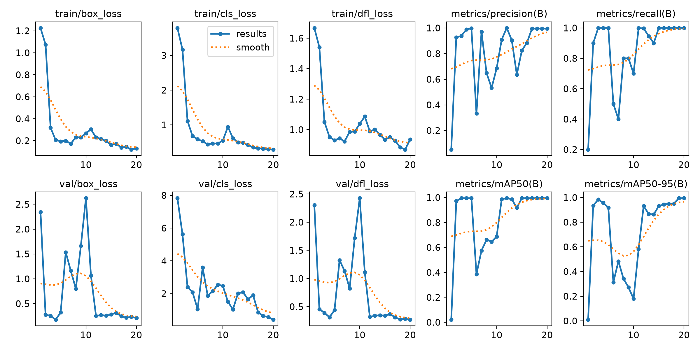

# Waste detection with YOLOv8

A reproducible path from COCO annotations to YOLO training, local image/video inference and held-out evaluation. Explicit checkpoints, inspectable data splits and no invented detections.

## Demo

<a href="docs/demo/validation-predictions.jpg"></a>

*Actual archived YOLOv8s validation output. The near-full-frame boxes expose the original annotation defect; this is a failure case, not validated localization. [Source and hash](docs/demo/README.md).*

The converter now uses real COCO boxes. A new localization demo, raw/prediction comparison and inference video remain **BLOCKED**: no source dataset or corrected trained checkpoint, no installed ML runtime, and denied network access. [Recovery attempt and genuine generation commands](docs/demo/GENERATION.md).

## Evidence and results

| Evidence | What it establishes |
| --- | --- |
| Dependency-free tests | Data geometry, split reproducibility, path/duplicate guards, CLI arguments and resource cleanup |
| Archived predictions and curves | An executed historical run that learned an incorrect full-frame labeling task |
| New mAP / per-class / latency / throughput | Not measured; requires retraining and actual held-out inference |

<details>
<summary>Historical training evidence — invalid as a localization benchmark</summary>



[Precision–recall curve](results/trash_detector-4/BoxPR_curve.png) · [Confusion matrix](results/trash_detector-4/confusion_matrix.png) · [Exact settings, numbers and limitations](docs/historical-results.md). These are retained outputs, not results of the corrected pipeline.

</details>

## Architecture


[Model boundary, preprocessing, augmentation, threshold/NMS choices, evaluation and error analysis](docs/engineering.md).

## Installation

Python 3.11/3.12; CPU by default. Run from the repository root. Use authorized images and trusted local checkpoints.

```bash
# Linux/macOS
python3.11 -m venv .venv
.venv/bin/python -m pip install -r requirements.txt
.venv/bin/python -m pip check
```

```powershell
# Windows PowerShell
py -3.11 -m venv .venv
.\.venv\Scripts\python.exe -m pip install -r requirements.txt
.\.venv\Scripts\python.exe -m pip check
```

Use that environment's Python for subsequent commands. A complete clean ML installation has not been verified in the current restricted environment. [Dependency and platform details](docs/usage.md).

## Inference and local interaction

```bash
python src/detect.py path/to/image.jpg --weights path/to/best.pt --device cpu
python src/realtime.py --weights path/to/best.pt --camera 0 --device cpu
```

Image output goes to a fresh `results/predict*` run. Webcam mode needs a desktop display; Q/ESC exits. No weights are downloaded implicitly.

For a local upload viewer with actual model predictions and confidence/NMS controls:

```bash
python -m pip install -r requirements-demo.txt
python src/viewer.py --weights path/to/best.pt --device cpu
```

Open `http://127.0.0.1:7861`. The viewer is implemented but not launched here: Gradio/YOLO dependencies and sockets are unavailable. It does not substitute prerecorded detections. [Generate a real comparison image or annotated MP4](docs/demo/GENERATION.md).

## Training and evaluation

The project references the [TACO Kaggle mirror](https://www.kaggle.com/datasets/kneroma/tacotrashdataset); the exact old dataset snapshot is unknown. Adapt these paths to an authorized archive:

```bash
python src/prepare_dataset.py --annotations data/data/annotations.json --images-dir data/data --output data_coco_yolo --seed 42
python src/utils.py data_coco_yolo
python src/train.py --data data_coco_yolo/data.yaml --weights yolov8n.pt --device cpu
python src/evaluate.py --data data_coco_yolo/data.yaml --weights results/waste_yolov8/weights/best.pt --latency-source path/to/test-image.jpg --device cpu
```

Preparation writes source hashes and split membership. Splits are image-level 80/10/10, not scene-grouped or stratified. Evaluation exports actual mAP50/mAP50-95, precision/recall, evaluated per-class results, confusion-derived counts, hardware/configuration, median/p95 latency and sequential images/second. Those exporters still need a real runtime run; no measured values are invented.

## Reproduction and verification

```bash
python -m unittest discover -s tests -v
python scripts/build_showcase.py
python scripts/check_assets.py
python scripts/check_format.py
```

[Actual test results and blocked runtime/lint/security checks](docs/verification.md) · [Full execution instructions](docs/usage.md) · [Design tradeoffs](docs/assets/decisions.svg) · [Metadata suggestion](docs/repository-metadata.md).

Project/checkpoint and dataset/image redistribution terms require review. No new dataset or model weights were committed. Existing history and checkpoint provenance are preserved; no deployment or valid model-quality benchmark is claimed.
