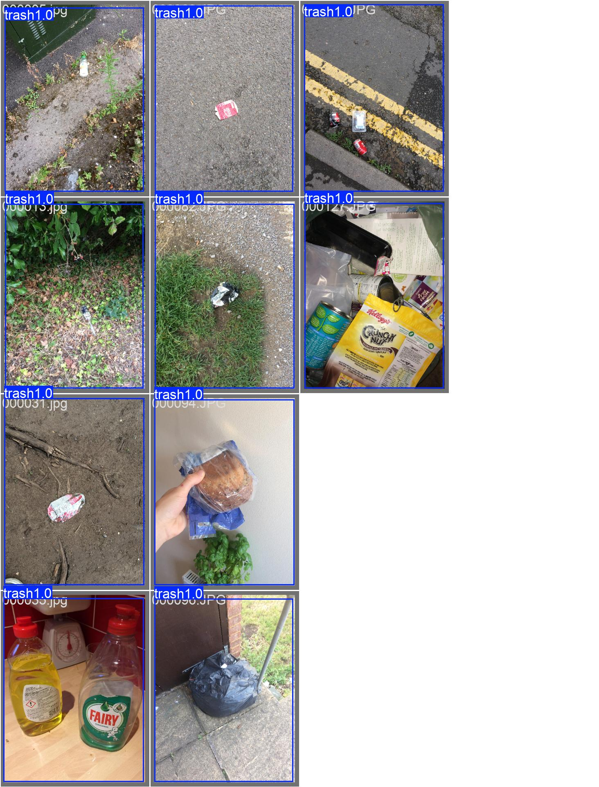

# Waste detection with YOLOv8

YOLOv8-based waste detection with dataset preparation, training, image inference, and webcam execution.

## Demo

<a href="docs/demo/validation-predictions.jpg"></a>

*Archived YOLOv8s validation predictions: blue bounding boxes with `trash` labels and confidence values. Click to inspect the original-size montage.*

**Known limitation:** these near-full-frame detections reflect an error in the original training labels. They show actual model output, not reliable object localization. The preparation pipeline now uses real COCO annotations; a replacement demo after retraining is **BLOCKED** by missing source data, corrected weights and ML dependencies. [Asset provenance](docs/demo/README.md) · [Historical results](docs/historical-results.md).

## Quick start

Use Python 3.11 or 3.12. Run from the repository root; environment activation is unnecessary.

**Linux/macOS**

```bash
python3.11 -m venv .venv
.venv/bin/python -m pip install -r requirements.txt
```

**Windows PowerShell**

```powershell
py -3.11 -m venv .venv
.\.venv\Scripts\python.exe -m pip install -r requirements.txt
```

With a local image and trusted trained checkpoint, run:

```bash
python src/detect.py path/to/image.jpg --weights path/to/best.pt --device cpu
python src/realtime.py --weights path/to/best.pt --camera 0 --device cpu
```

Replace `python` with the virtual-environment executable above. Image predictions and confidence-bearing labels are saved to a new `results/predict*` directory. Webcam mode needs a camera and desktop display; press Q or ESC to exit. No weights are downloaded automatically.

## Data and training

The original project references the [TACO Kaggle mirror](https://www.kaggle.com/datasets/kneroma/tacotrashdataset). Obtain authorized images and COCO annotations before training. The converter produces image-level 80/10/10 splits, maps category IDs and records source hashes and split membership; it rejects missing images, duplicate content and nonempty outputs.

```bash
python src/prepare_dataset.py --annotations data/data/annotations.json --images-dir data/data --output data_coco_yolo --seed 42
python src/train.py --data data_coco_yolo/data.yaml --weights yolov8n.pt --device cpu
```

Paths assume the illustrated archive layout and existing trusted `yolov8n.pt` starting weights. Adapt them to your files. See [usage and evaluation](docs/usage.md) for installation details, training options, held-out metrics, latency measurement and demo reproduction.

## Verification and status

Dependency-free unit tests cover dataset preparation, box conversion, CLI arguments and webcam cleanup:

```bash
python -m unittest discover -s tests -v
```

The recorded run passed **17 tests**. Model calls in CLI tests are mocked; model quality and clean ML installation remain unverified. CI is configured for Linux/Windows; remote execution is pending. [Actual checks and blockers](docs/verification.md).

This is an experimental project. Historical model scores are not accepted localization benchmarks. Datasets and new weights are excluded from Git; retained checkpoints are documented as historical artifacts. Project, dataset, image and model redistribution terms still require review. [Licensing and artifact notes](docs/historical-results.md) · [Repository description suggestion](docs/repository-metadata.md).
