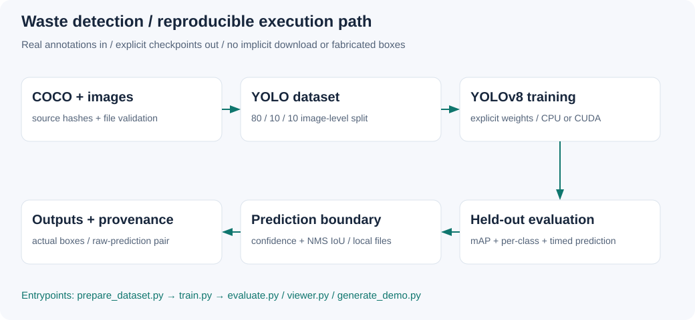
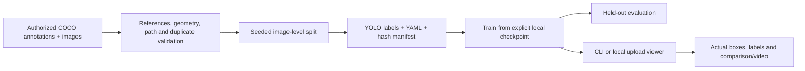
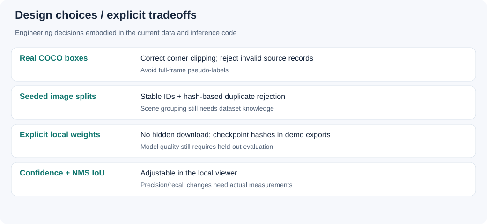

# Detection pipeline and experimental method

## Model boundary

The scripts call Ultralytics YOLOv8 detection checkpoints; they do not implement a custom neural network. The [upstream architecture](https://docs.ultralytics.com/models/yolov8/) uses a feature-extraction backbone/neck and an anchor-free detection head. New training defaults to an explicitly supplied checkpoint; the example uses YOLOv8n for a small compute footprint. The archived run used YOLOv8s. A smaller model's speed or accuracy on this dataset has not been measured here.

Ultralytics owns image resizing/letterboxing, tensor normalization, training augmentation and postprocessing. The repository's converter owns the annotation contract: COCO pixel boxes → intersection with image boundaries → normalized YOLO center/width/height. It does not generate synthetic object boxes. Category IDs are remapped consistently and the generated YAML is authoritative.

`train.py` explicitly sets epochs/image size/batch/workers/device/seed/deterministic mode. Other augmentation/optimizer defaults belong to the pinned Ultralytics runtime and should be read from the actual run's saved args. Do not describe an unexecuted experiment as using the archived run's settings. Changes to augmentation require a new validation experiment, not a guessed improvement.

## Data flow

Splitting is deterministic for input ordering, but **not** scene-grouped or stratified. Byte hashes catch identical files, not re-encoded copies or correlated scenes. Review scene overlap and class counts. Rare classes may have no validation targets: the per-class exporter lists only classes actually evaluated, rather than substituting global mean AP. Crowd-only images need review because YOLO text labels cannot encode ignore/crowd regions.

## Inference controls

`prediction.py` restricts the viewer/generator boundary to existing local images, validates finite confidence/IoU values and returns actual model results. `viewer.py` exposes confidence and NMS IoU independently and renders BGR predictions as RGB. Raising confidence discards low-scoring boxes; changing NMS IoU changes which overlapping boxes survive. Neither control is a substitute for AP/recall measurement. No claim about an optimal threshold is made.

The optional Gradio viewer binds only to loopback, disables sharing/analytics, serializes model calls and limits queue size. Model loading happens once after CLI validation. It is a local experiment interface, not an authenticated production service. Use trusted checkpoints and non-sensitive inputs; Gradio may retain temporary upload files. This environment cannot launch it because dependencies and network sockets are unavailable.

## Evaluation protocol

Keep the test split untouched while choosing settings on validation data. Record annotation/checkpoint hashes, split manifest, exact command, saved run args and software/hardware. `evaluate.py` uses batch 1, validation confidence 0.001 and actual validator outputs for mAP50/mAP50-95/precision/recall/per-class metrics. The confusion matrix uses its validator matching policy; cross-class confusion contributes to both FP and FN. Do not equate those counts to the PR curve's best-F1 point.

Latency uses repeated same-image `model.predict`, explicit warmup and CUDA synchronization. It includes file read, preprocessing, inference and postprocessing, excludes plotting/export and reports median/p95 plus sequential images/second from the mean. That rate is not batched throughput or webcam FPS. Record power/device/thread configuration when comparing machines. The runtime API is still awaiting an actual dependency-enabled check.

## Evidence and error analysis

The retained prediction montage and [loss/metric trajectories](../results/trash_detector-4/results.png), [PR curve](../results/trash_detector-4/BoxPR_curve.png) and [confusion matrix](../results/trash_detector-4/confusion_matrix.png) are genuine historical artifacts. They come from a single-class run with full-frame target labels. High AP on that target does not establish localization. The montage visibly shows the model learning the wrong task; the historical numbers must not be used as current benchmark results.

For new error analysis, inspect low-confidence misses, small/occluded waste, crowded scenes and foreground/background confusions. Record successful and failed examples from the same held-out split, with unchanged inputs and checkpoint/configuration. Domain shift across lighting, backgrounds, cameras and waste categories remains unmeasured. No new success/failure gallery has been manufactured in place of missing predictions.

